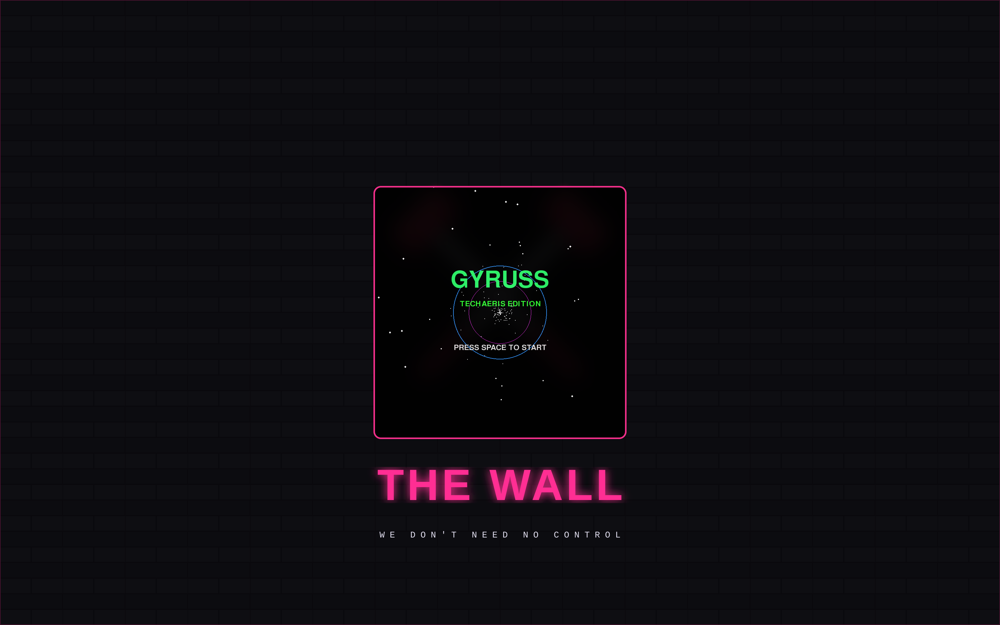
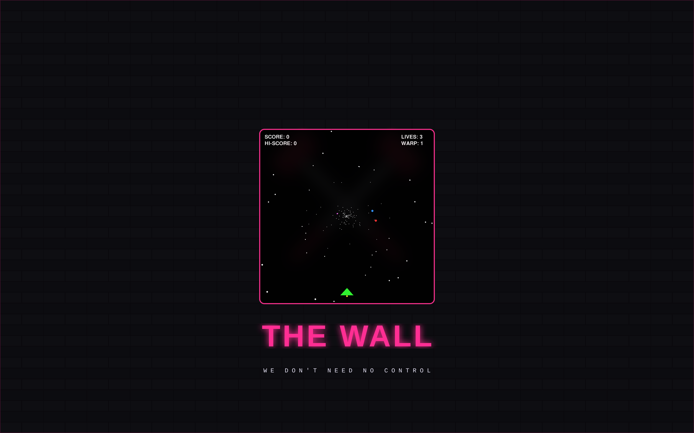

# Gyruss '83: TECHAERIS Edition



An open-source, fully playable arcade clone of the 1983 classic **Gyruss**, developed in Python using Pygame. This special **TECHAERIS Edition** features dynamic, procedurally generated audio effects and a neon-themed glowing intro animation.

## Screenshots

<p align="center">
  
  
</p>

## Features

- **360-Degree Orbital Flight:** Spin around the perimeter with responsive physics and movement.
- **Warp Starfield Effect:** Fully simulated 3D depth starfield accelerating from a vanishing center point.
- **Dynamic Waves:** Procedural enemies spiral out from the center in formation patterns, firing energy bolts towards the outer edge.
- **Asteroid & Laser Hazards:** Dodge indestructible obstacles passing through the perimeter.
- **Double-Shot Power-Up:** Shoot down magenta bonus formation ships to double your firepower.
- **Procedural Synthesizer Audio:** Uses real-time raw PCM byte stream synthesis for laser firing, explosions, power-ups, and player damage—no external sound files required!
- **Dynamic Opening Screen:** Color-cycling retro title, concentric radar tracking rings, and custom warp sequence.

## Controls

- **Orbit Left / Rotate Counter-Clockwise:** `Left Arrow` or `A`
- **Orbit Right / Rotate Clockwise:** `Right Arrow` or `D`
- **Fire Lasers:** `Spacebar`
- **Start / Restart Game:** `Spacebar` (at title screen) / `R` (at Game Over screen)

## Prerequisites & Installation

### On Arch Linux / Omarchy

Install Python and Pygame dependencies directly:
```bash
sudo pacman -S python-pygame
```

### Generic Linux / Pip

```bash
pip install -r requirements.txt
```

## Running the Game

Run the main game with the wrapper launcher script:
```bash
chmod +x run.sh
./run.sh
```

### Desktop Menu Integration (Optional)

Install the application shortcut to your desktop menu launch system:
```bash
mkdir -p ~/.local/share/applications
cp gyruss.desktop ~/.local/share/applications/
chmod +x ~/.local/share/applications/gyruss.desktop
```

## License

This project is licensed under the MIT License - see the [LICENSE](LICENSE) file for details.